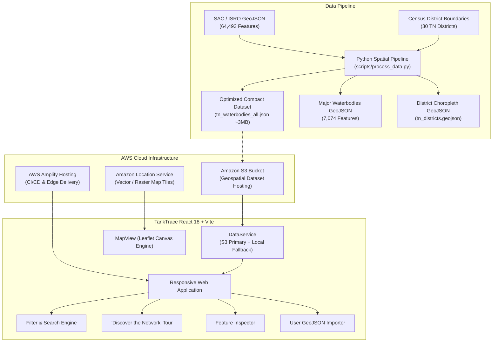

# TankTrace: Mapping Tamil Nadu's Hidden Water Network

> **AWS Builder Center "Weekend Challenge: Map It" Submission**  
> An interactive geospatial dashboard illuminating 64,493 water bodies across Tamil Nadu, highlighting ancient cascading *Eri* tank networks and modern hydrological infrastructure using **Amazon Location Service**, **Amazon S3**, and **AWS Amplify**.

---

## 🌊 Overview

Tamil Nadu lies in the rain-shadow of the Western Ghats and relies overwhelmingly on the brief, intense Northeast Monsoon (October to December). Over centuries, dynasties (Pallava, Chola, and Pandya) engineered one of the world's most intricate rainwater harvesting networks: chains of interconnected earthen irrigation tanks (*Eris*).

**TankTrace** makes this hidden infrastructure visible, quantifiable, and explorable. Every data point on the map represents a real, verified water body mapped by the **Space Applications Centre (SAC), ISRO** and the **National Water Informatics Centre (NWIC)**.

### Key Discoveries from the Verified Dataset
- **64,493 Total Water Bodies** across all 30 districts of Tamil Nadu.
- **696,538 Hectares (~6,965 km²)** of total water surface storage.
- **97.1% Man-Made**: Over 62,600 structures are human-engineered cascading tanks (*Eris*) and ponds, demonstrating that Tamil Nadu's water security is predominantly community-engineered rather than purely natural.
- **Epicenters of Tank Density**: Pudukkottai leads the state with 6,793 water bodies (6,693 eris), followed by Sivaganga (5,659 water bodies, 100% man-made eris) and Kanchipuram (3,970 water bodies).

---

## 🏛️ System Architecture



---

## ✨ Core Features

1. **Interactive High-Performance Map**:
   - Centered on Tamil Nadu (`lat: 10.8505, lng: 78.6569`).
   - Integrated with **Amazon Location Service** via configurable API Key, with seamless fallback to Carto Dark Matter, Carto Positron, Satellite, and OpenStreetMap.
   - Dual-layer rendering: District polygon boundaries (choropleth colored by eri density) and HTML5 Canvas-accelerated water body markers scaled to surface area.
   - Click-to-inspect feature attributes and hover tooltips.

2. **Explore & Dynamic Filtering**:
   - Filter by **30 Tamil Nadu Districts** (Pudukkottai, Sivaganga, Kanchipuram, Thiruvallur, Thanjavur, etc.).
   - Filter by **Classification / Type** (Tank/Pond, Reservoir/Barrage, Lake/Pond, Aquaculture Pond, Wetland/Lagoon).
   - Filter by **Turbidity State** (High, Moderate, Low) and **Aquatic Vegetation** presence.
   - Filter by **Surface Area** threshold (>5 ha, >25 ha, >100 ha).
   - Real-time search by waterbody name or unique ID.
   - Live counter displaying active filtered count versus total dataset.

3. **Guided Storytelling Tour ("Discover the Network")**:
   - **Step 1: The Cascading Landscape** — Statewide geomorphology and monsoon dependency.
   - **Step 2: The Southern Eri Epicenters** — Flying to Pudukkottai & Sivaganga (12,400+ tanks).
   - **Step 3: The Northern Pallava Strongholds** — Kanchipuram and Thiruvallur's historic feeder reservoirs.
   - **Step 4: Modern Infrastructure & Regulators** — Examining how Mettur (Stanley Reservoir) and Bhavanisagar feed downstream delta tanks.

4. **Graceful User GeoJSON Import**:
   - Drag-and-drop or file upload for custom GeoJSON / survey data.
   - Includes a one-click **"Load Verified Sample"** button (pre-loads 50 landmark tanks and historical reservoirs).
   - Validation against Tamil Nadu coordinates with helpful warnings for out-of-bounds geometries.

5. **No Synthetic / Hallucinated Data**:
   - Follows strict scientific integrity: no fabricated groundwater stress numbers, simulated drought risk indices, or synthetic map markers.

---

## 🛠️ Technical Stack

- **Frontend:** React 18, Vite 5, TypeScript 5, Tailwind CSS 3
- **Mapping Engine:** Leaflet with HTML5 Canvas vector renderer
- **Cloud & Geospatial Services:**
  - **Amazon Location Service:** Basemap tile provider
  - **Amazon Simple Storage Service (S3):** Processed dataset hosting
  - **AWS Amplify:** Automated CI/CD deployment
- **Icons & UI:** Lucide React, Glassmorphism, Tailwind scrollbars

---

## 🚀 Quickstart: Local Setup

### Prerequisites
- Node.js 18+ (tested on Node v20/v24)
- npm 9+
- Python 3.10+ *(only needed if you wish to re-run the dataset processing pipeline)*

### 1. Clone the repository
```bash
git clone https://github.com/your-username/tanktrace.git
cd tanktrace
```

### 2. Install dependencies
```bash
npm install
```

### 3. Environment configuration
Copy the sample environment file:
```bash
cp .env.example .env
```
*(The application works immediately out-of-the-box in Fallback Mode without AWS credentials. To enable Amazon Location Service, see the AWS Setup section below).*

### 4. Run the development server
```bash
npm run dev
```
Open [http://localhost:5173](http://localhost:5173) in your browser.

### 5. Run tests & production build
```bash
npm run build
npm test
```

---

## ☁️ AWS Setup Instructions

### 1. Amazon Location Service Configuration
1. Open the **AWS Management Console** and navigate to **Amazon Location Service**.
2. Click **Maps** -> **Create map**.
   - Map name: `explore.map` (or any custom name).
   - Map style: Select an Esri, HERE, or Open Data style (e.g. *Esri Light* or *HERE Explore*).
3. Click **API Keys** -> **Create API key**.
   - Set the API key name (e.g. `TankTraceMapKey`).
   - Grant read permissions for your created map resource: `geo:GetMap*`.
4. Copy the API Key and update your `.env` file:
   ```env
   VITE_AWS_LOCATION_API_KEY=v1.public.your_api_key_here
   VITE_AWS_LOCATION_MAP_NAME=explore.map
   VITE_AWS_LOCATION_REGION=us-east-1
   ```

### 2. Amazon S3 Dataset Storage (Optional)
To host the processed geospatial data on S3:
1. Create a public or CloudFront-backed S3 bucket (e.g. `tanktrace-geospatial-bucket`).
2. Upload the files from `public/data/`:
   - `tn_districts.geojson`
   - `tn_summary.json`
   - `tn_waterbodies_all.json`
   - `tn_waterbodies_major.geojson`
   - `sample_import.geojson`
3. Configure Bucket CORS policy:
   ```json
   [
     {
       "AllowedHeaders": ["*"],
       "AllowedMethods": ["GET", "HEAD"],
       "AllowedOrigins": ["*"],
       "ExposeHeaders": []
     }
   ]
   ```
4. Set `VITE_S3_DATA_URL` in your `.env`:
   ```env
   VITE_S3_DATA_URL=https://tanktrace-geospatial-bucket.s3.us-east-1.amazonaws.com/data
   ```

*(If `VITE_S3_DATA_URL` is not set or fails, TankTrace automatically falls back to bundled local data with zero user disruption).*

---

## 📦 AWS Amplify Deployment

This project includes an AWS Amplify build specification (`amplify.yml`):

```yaml
version: 1
frontend:
  phases:
    preBuild:
      commands:
        - npm ci
    build:
      commands:
        - npm run build
  artifacts:
    baseDirectory: dist
    files:
      - '**/*'
  cache:
    paths:
      - node_modules/**/*
```

### Steps to Deploy:
1. Push your repository to GitHub, GitLab, or AWS CodeCommit.
2. In the AWS Management Console, open **AWS Amplify**.
3. Click **Deploy an app** -> Select your Git provider and repository branch (`main`).
4. In **App settings** -> **Environment variables**, optionally add:
   - `VITE_AWS_LOCATION_API_KEY`
   - `VITE_AWS_LOCATION_MAP_NAME`
   - `VITE_AWS_LOCATION_REGION`
   - `VITE_S3_DATA_URL`
5. Click **Save and deploy**. Amplify will automatically run `npm ci` and `npm run build`, hosting the application on Amazon CloudFront edge nodes.

---

## 🔒 Security & Secrets Hygiene

- No AWS secret keys, access tokens, or private credentials are committed to the codebase or included in client bundle files.
- Amazon Location Service uses scoped API Keys with restricted `geo:GetMap*` actions.
- `.env` and `.env.local` are explicitly excluded in `.gitignore`.
- S3 endpoints only serve public read-only geospatial GeoJSON/JSON assets.

---

## 📚 Data Source Attribution & License

- **Water Bodies Layer:** Space Applications Centre (SAC), Indian Space Research Organisation (ISRO) & National Water Informatics Centre (NWIC), Ministry of Jal Shakti. Published under Government Open Data policies for public hydrological assessment.
- **District Boundaries:** Open geodata boundary extracts based on Census of India delineations.
- **Basemaps:** Amazon Location Service, OpenStreetMap contributors, and CARTO.

---

## ⚠️ Limitations & Future Work

- **Temporal Satellite Monitoring:** The current dataset captures spatial footprints and turbidity classifications from the SAC National Wetland Inventory baseline. Incorporating real-time Sentinel-2 or Landsat imagery via AWS Open Data Registry would enable seasonal water level fluctuation tracking.
- **Micro-Canal Vectors:** While individual water body points and boundaries are mapped, many smaller earthen feeder canals (*Varathu Vaikkal*) between cascading eris are not fully digitized in state-level datasets.
